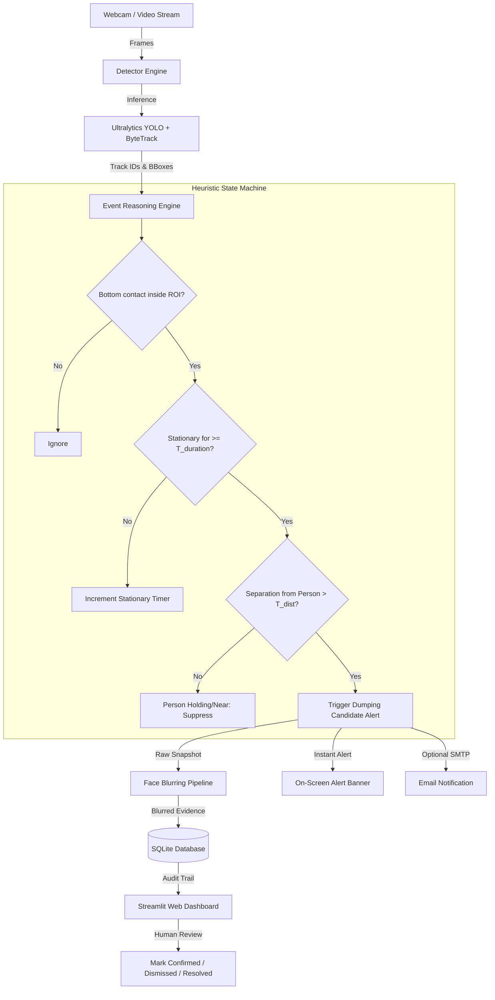

# ♻️ AI Illegal Dumping Detection System

[](https://www.python.org/)
[](https://github.com/ultralytics/ultralytics)
[](https://github.com/ifzhang/ByteTrack)
[](https://streamlit.io/)
[](https://www.sqlite.org/)
[](#privacy--security-safeguards)

An AI-powered smart waste surveillance system designed for municipal authorities and smart cities. It continuously monitors designated public zones through live video feeds, tracks people and potential waste objects across time, detects candidate illegal waste abandonment/dumping events, logs persistent incident records into SQLite with privacy-preserving blurred evidence frames, and provides a web dashboard for human officer verification and auditing.

---

## 📑 Table of Contents
1. [System Architecture](#system-architecture)
2. [Event Detection Logic & Heuristics](#event-detection-logic--heuristics)
3. [Privacy & Security Safeguards](#privacy--security-safeguards)
4. [Technology Stack](#technology-stack)
5. [Project Structure](#project-structure)
6. [Configuration Guide](#configuration-guide)
7. [Installation & Execution (Windows, macOS, Linux)](#installation--execution)
8. [Automated Verification & Unit Tests](#automated-verification--unit-tests)
9. [Web Dashboard Capabilities](#web-dashboard-capabilities)
10. [Troubleshooting & FAQs](#troubleshooting--faqs)
11. [Known Model Limitations](#known-model-limitations)

---

## 🏛️ System Architecture



---

## 🧠 Event Detection Logic & Heuristics

> [!IMPORTANT]
> **Why proximity does not equal illegal dumping:**
> Simply detecting a person standing near a bottle or bag does *not* prove illegal dumping. A pedestrian holding a water bottle, sitting on a bench with a backpack, or setting a bag down temporarily while waiting for transit is normal public behavior. 

To prevent false accusations, the system treats every candidate alert as a **"Suspected Incident Requiring Human Verification"** based on explicit multi-frame spatial-temporal reasoning:

1. **Spatial Filtering (Designated ROI):**
   - The ground contact point (bottom-center of bounding box) of the candidate waste item must lie strictly inside the configured non-convex/convex Region of Interest polygon (`roi_polygon_normalized`).
2. **Stationary Displacement Verification:**
   - The object must maintain its coordinates within a spatial threshold (`stationary_movement_threshold_pixels = 25px`) across consecutive frames.
3. **Temporal Duration Gate:**
   - The object must remain stationary inside the ROI for at least `event_duration_threshold_seconds` (default: 3.0 to 5.0 seconds).
4. **Human Separation Criterion:**
   - The distance between the stationary object and any detected human must exceed `person_separation_distance_pixels` (default: 120px), proving the item is abandoned rather than actively held or carried.
5. **Duplicate-Alert Suppression:**
   - The engine maintains a spatial-temporal cache of recent alerts. Once an alert triggers for an object or location, duplicate alerts are suppressed for `duplicate_cooldown_seconds` (default: 30 seconds).

---

## 🛡️ Privacy & Security Safeguards

- **Zero Face Recognition:** The system does not employ facial recognition, feature embedding, or demographic profiling. No individual identity is stored or queried.
- **Best-Effort Face Blurring:** Every captured evidence image automatically passes through OpenCV Haar Cascades and upper-body head region blurring with strong Gaussian kernels (`k=35`).
- **Data Minimization:** Continuous video streams are processed in memory and never written to disk. Only single-frame incident evidence snapshots are retained.
- **Configurable Retention Policy:** Automated purging deletes evidence frames and audit logs older than `retention_days` (default: 30 days) to comply with data privacy standards.
- **Human-in-the-Loop Governance:** The system never issues fines, automated penalties, or public accusations. Every alert remains in `Needs Review` status until audited by an authorized officer.

---

## 🛠️ Technology Stack

| Layer | Component | Description |
|---|---|---|
| **Language** | Python 3.10 / 3.11 | Core runtime environment |
| **Object Detection** | Ultralytics YOLO (v8/v11) | Real-time multi-class object detection (`yolov8n.pt`) |
| **Object Tracking** | ByteTrack / Trackers | Persistent ID assignment across occlusions |
| **Computer Vision** | OpenCV (`cv2`) | Video ingestion, polygon geometry, HUD overlay, face blurring |
| **Audit Dashboard** | Streamlit | Responsive smart-city operations web app |
| **Persistence** | SQLite3 | Local high-performance ACID incident database |
| **Analytics** | Pandas & NumPy | Incident frequency aggregation, CSV audit export |
| **Notifications** | Python `smtplib` | Optional SMTP TLS email dispatches |
| **Testing** | Pytest | Unit and integration test suite |

---

## 📁 Project Structure

```
ai_illegal_dumping_detection/
├── app.py                   # Main CLI video monitoring entrypoint & synthetic demo generator
├── detector.py              # YOLO inference, ByteTrack wrapper, and smart HUD rendering
├── dashboard.py             # Streamlit web application for incident review & analytics
├── database.py              # SQLite manager with IST timestamps, indexes, & retention purge
├── event_detection.py       # Spatial-temporal state machine, ROI testing, & face blurring
├── config.json              # Configurable camera, model, ROI, thresholds, & site coordinates
├── requirements.txt         # Project dependencies
├── .env.example             # Template for optional SMTP email credentials
├── .gitignore               # Ignored local files (models, evidence images, databases)
├── README.md                # Comprehensive documentation and runbook
├── models/                  # Directory for YOLO model weights
├── evidence/                # Directory for privacy-blurred evidence snapshots
└── tests/                   # Automated Pytest suite
    ├── __init__.py
    ├── test_database.py     # SQLite schema, insertions, status updates, & retention tests
    ├── test_event_detection.py # Point-in-polygon, stationary timing, & cooldown tests
    └── test_config.py       # Config validation and normalized ROI scaling tests
```

---

## ⚙️ Configuration Guide (`config.json`)

```json
{
  "camera": {
    "camera_index": 0,
    "demo_video_path": "demo_video.mp4",
    "frame_width": 1280,
    "frame_height": 720
  },
  "site": {
    "site_id": "SITE-DELHI-001",
    "site_name": "Rajpath Central Green - Sector 4",
    "latitude": 28.6139,
    "longitude": 77.2090,
    "timezone": "Asia/Kolkata"
  },
  "detection": {
    "model_path": "models/yolov8n.pt",
    "confidence_threshold": 0.35,
    "tracker_type": "bytetrack.yaml",
    "person_classes": ["person"],
    "waste_classes": ["bottle", "cup", "backpack", "handbag", "suitcase", "box", "bowl", "waste"]
  },
  "event_logic": {
    "roi_polygon_normalized": [
      [0.15, 0.35],
      [0.85, 0.35],
      [0.90, 0.88],
      [0.10, 0.88]
    ],
    "event_duration_threshold_seconds": 3.0,
    "stationary_movement_threshold_pixels": 25.0,
    "person_separation_distance_pixels": 120.0,
    "duplicate_cooldown_seconds": 30.0
  },
  "evidence": {
    "save_evidence": true,
    "evidence_directory": "evidence",
    "blur_faces": true,
    "face_blur_factor": 35,
    "retention_days": 30
  },
  "database": {
    "database_path": "data/dumping_incidents.db"
  },
  "notifications": {
    "email_enabled": false
  }
}
```

---

## 🚀 Installation & Execution

### Prerequisites
- Python 3.10 or 3.11 installed.
- Git (optional).

### 1. Windows Installation (PowerShell / Command Prompt)

```powershell
# Navigate into the project folder
cd "c:\Users\raj19\VSCODE\Ai Dump Detection"

# Create a virtual environment
python -m venv venv

# Activate the virtual environment
.\venv\Scripts\Activate.ps1

# Upgrade pip and install dependencies
pip install --upgrade pip
pip install -r requirements.txt
```

### 2. Linux / macOS Installation (Bash / Zsh)

```bash
# Navigate into project directory
cd ai_illegal_dumping_detection

# Create virtual environment
python3 -m venv venv

# Activate virtual environment
source venv/bin/activate

# Upgrade pip and install dependencies
pip install --upgrade pip
pip install -r requirements.txt
```

---

### 3. Running Real-Time Detection

#### A. Live Webcam Monitoring
```bash
# Starts monitoring with default camera index 0
python app.py

# Or specify a custom camera index (e.g. external USB webcam index 1)
python app.py --source 1
```

#### B. Prerecorded Video / Demo Mode (No Webcam Required)
If you do not have a physical webcam attached, run with the `--demo` flag. The system will automatically generate a high-definition synthetic demonstration video (`demo_video.mp4`) simulating a pedestrian entering the ROI, discarding an object, and leaving:
```bash
python app.py --demo
```

#### C. Headless Server Mode
For automated servers or continuous background monitoring without an OpenCV GUI window:
```bash
python app.py --source 0 --headless
```

---

### 4. Launching the Web Dashboard

Open a separate terminal window and run:

```bash
streamlit run dashboard.py
```
The dashboard will open automatically in your browser at `http://localhost:8501`.

---

### 5. Running the Automated Test Suite

Run unit and integration tests covering database operations, spatial geometry, event timing logic, and configuration loading:

```bash
pytest tests/ -v
```

---

## 📊 Web Dashboard Capabilities

1. **Live Incident Queue:** Search, sort, and filter incidents by date, review status (`Needs Review`, `Confirmed`, `Dismissed`, `Resolved`), and waste category.
2. **Evidence Inspection Panel:** View high-resolution evidence snapshots with incident bounding boxes and automated privacy face blurring.
3. **Officer Audit Form:** Update incident status, append inspection notes, and record reviewing officer credentials into the permanent audit trail.
4. **Analytics Charts:** Inspect daily incident frequency trends and waste category distributions.
5. **Interactive Site Map:** View clustered incident locations with direct links to Google Maps coordinates.
6. **CSV Audit Export:** Download complete incident history with timestamps, GPS coordinates, reviewer audit notes, and confidence scores.
7. **Privacy Retention Purge:** One-click maintenance tool to purge records and image files exceeding municipal retention limits.

---

## 🔧 Troubleshooting & FAQs

### Q1: "Cannot open camera index 0" or black screen
- **Check Camera Permissions:** Ensure Windows Settings > Privacy & Security > Camera allows desktop applications access.
- **Select External Camera:** Try running `python app.py --source 1` or `python app.py --source 2`.
- **Use Demo Video:** Run `python app.py --demo` to test detection without camera hardware.

### Q2: "Failed to download YOLO model weights"
- The system automatically downloads `yolov8n.pt` on first run. If your environment has a restricted internet proxy, download `yolov8n.pt` manually from [Ultralytics Releases](https://github.com/ultralytics/assets/releases/download/v8.2.0/yolov8n.pt) and place it inside the `models/` directory.

### Q3: How do I change the monitored "No Dumping" Zone?
- Edit `roi_polygon_normalized` in `config.json`. Coordinates are specified in normalized `[x, y]` pairs between `0.0` and `1.0`, adapting automatically to any camera resolution.

---

## ⚠️ Known Model Limitations

1. **General Pretrained Weights:** The default `yolov8n.pt` model is pretrained on the MS COCO dataset (80 common object classes). While it reliably detects people, bottles, backpacks, handbags, and suitcases, it may not distinguish between a crumpled paper wrapper and organic foliage without specialized fine-tuning on a domain-specific municipal waste dataset.
2. **Camera Angles & Occlusion:** Extreme top-down or long-range fisheye camera placements may degrade bounding box aspect ratios. Mounting cameras at 15° to 35° tilt angles is recommended.
3. **Adverse Weather & Night Lighting:** Low-light night scenes or heavy rain can introduce noise. Infrared (IR) illuminators or streetlight-illuminated scenes yield optimal performance.
4. **Legal Disclaimer:** This system is an operational decision-support tool. Detections must be audited by certified human personnel before any statutory action or notice is issued.

